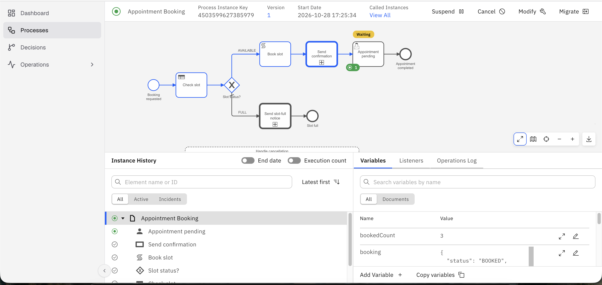

# Hospital Appointment Booking – Camunda 8

## RA2411003012475
## Srinithy P S

## Overview

This project implements a hospital appointment booking workflow using Camunda 8. It uses BPMN for process modelling, DMN for slot availability decisions, and a reusable child process for sending Telegram notifications. It also supports appointment cancellation through a message-triggered event subprocess.

## Files

- `bpmn/appointment-booking.bpmn` – Parent booking process.
- `bpmn/appointment-booking-propagate-all.bpmn` – Process version for comparing variable propagation.
- `bpmn/send-notification.bpmn` – Reusable notification child process.
- `dmn/slot_decision.dmn` – DMN decision table for slot availability.
- `test-data/` – Test inputs for booking and cancellation scenarios.
- `docs/screenshots/` – Screenshots of process execution in Operate.

## Deployment and Testing

1. Deploy the DMN file, child BPMN process, and parent BPMN process to Camunda 8.
2. Configure the `TELEGRAM_BOT_TOKEN` secret.
3. Run the test cases for an available slot, a full slot, and a successful booking followed by cancellation.
4. Verify the parent process, child process, and cancellation path in Camunda Operate.

## Test Cases

- **TC1 – Available Slot:** The appointment is booked and a confirmation notification is sent.
- **TC2 – Full Slot:** The booking is rejected and a slot-full notification is sent.
- **TC3 – Cancellation:** The booked slot is released and a cancellation notification is sent.

## Variable Mapping

The project compares selective variable mapping with propagation of all variables to the child process. Selective mapping passes only the required variables, such as `recipientId` and `messageText`, while propagation passes all available parent variables.

## Screenshots

## Outcome

The project demonstrates appointment booking, DMN-based decision-making, reusable child processes using Call Activities, Telegram notifications through a REST Outbound Connector, variable mapping, and cancellation handling in Camunda 8.
